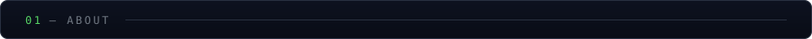
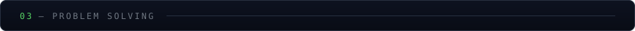
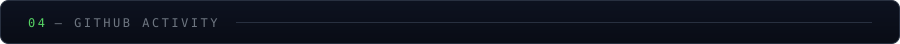

 
 

&nbsp;
&nbsp;
&nbsp;

 

 

I build fast, type-safe web apps with clean architecture and sharp UX — mostly in React and Next.js, increasingly with LLMs wired into real product workflows.

Open to collaborating on full-stack projects, open-source tools, or anything AI-integrated.

 

 

 
 

 

&nbsp;

 

 

&nbsp;

 

 

Thanks for stopping by — always happy to connect.

